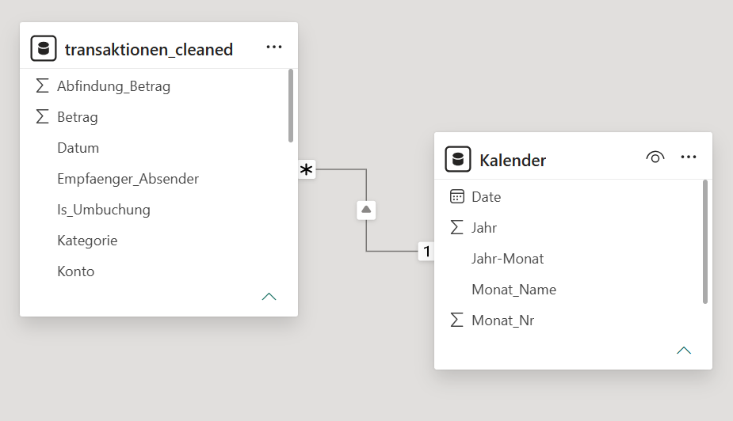
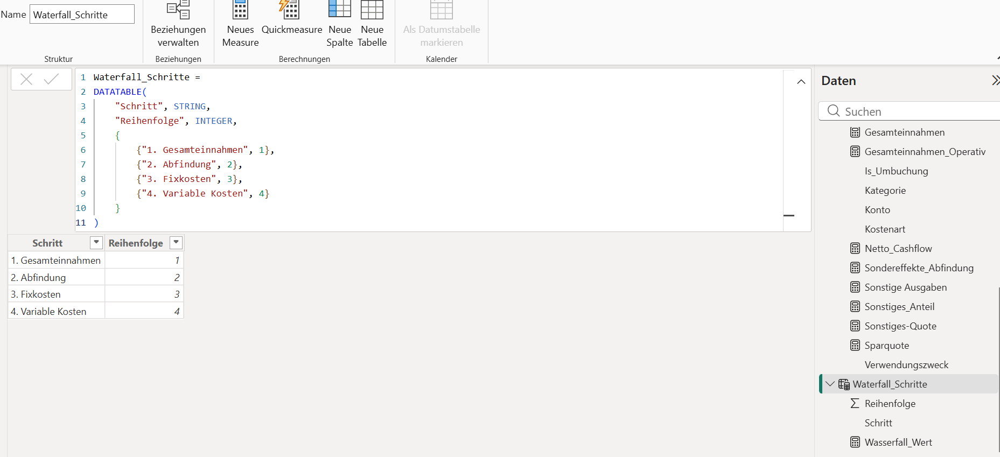
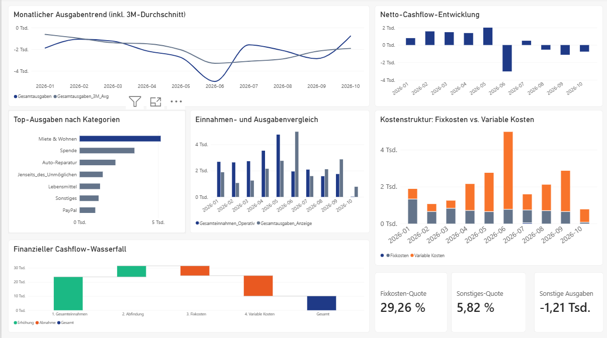

# 📊 Executive Financial & Cashflow Analytics: Power BI & Advanced ETL

> Eine professionelle, DSGVO-konforme End-to-End-Datenpipeline zur intelligenten Konsolidierung, Strukturierung und Analyse privater Bankdaten mittels Excel, Power Query, DAX und Power BI – inklusive integrierter mathematischer Anonymisierung für den sicheren öffentlichen GitHub-Export.

---

## 🚀 Executive Summary

* **Herausforderung:** Fragmentierte Rohdaten aus mehreren Bankkunden (CSV-Ausweitung) erschwerten eine transparente, tagesaktuelle Finanz- und Liquiditätssteuerung[cite: 9]. Zudem mussten hochsensible Einmaleffekte (wie vertraglich geschützte Abfindungen) für eine öffentliche Portfolio-Präsentation rechtssicher und unkenntlich verschleiert werden[cite: 9].
* **Lösung:** Entwicklung einer lokalen Data-Pipeline von der Rohdatenbereinigung über ein relationales Sternschema bis hin zu einem interaktiven C-Level Executive-Dashboard in Power BI, ergänzt durch eine smarte ETL-Skalierungslogik[cite: 9].
* **Kern-Ergebnis:** Vollständige finanzielle Transparenz bei gleichzeitiger Wahrung von Vertraulichkeit und Datenschutz durch eine zweistufige Skalierung der Transaktions- und Sondersachverhalte[cite: 9].

---

## 🛠️ Tech Stack & Infrastructure Setup

### Key Technologies

* **Datenaufbereitung & RegEx:** Excel (Erweiterte Array-Formeln, regelbasierte Transaktions-Kategorisierung)[cite: 10]
* **ETL & Data Modeling:** Power Query (Schema-Harmonisierung, Fehlerbehandlung, Spaltenoptimierung)[cite: 10]
* **Business Intelligence & DAX:** Power BI Desktop, DAX-Measures (gleitende Durchschnitte, Quoten, dynamische Hilfstabellen)[cite: 10]
* **UI/UX Design:** Modern Fintech / Nordic Corporate Design (`#1E3A8A`, Cool Gray, Warm Amber, Soft Emerald)[cite: 10]
* **Datenschutz & Anonymisierung:** Lokale Verarbeitung ohne Cloud-Upload sowie mathematische Skalierungsfaktoren zum Schutz sensibler Vertragsdaten[cite: 10].

### Warum diese Architektur für den Portfolio-Export entscheidend ist (Privacy & Security)

1. **100 % DSGVO- & Data Privacy Compliance:** Sämtliche rohen Bankdaten und Kontoauszüge verbleiben strikt in der lokalen Umgebung[cite: 10].
2. **Mathematische Anonymisierung (Zero-Leakage):** Um sensible Sondersachverhalte (Abfindungen) und reale Vermögenswerte vor unbefugten Blicken zu schützen, durchlaufen die Werte eine kontrollierte ETL-Skalierung, wodurch echte Beträge unkenntlich gemacht werden[cite: 10].
3. **Visuelle Proportionalität:** Die Skalierung bricht das Dashboard nicht – alle prozentualen KPIs (Fixkosten-Quote, Sparquote) und relativen Verläufe bleiben mathematisch exakt intakt[cite: 10].

---

## ⚡ Logic & Architecture Overview

### 🔒 Datenschutz durch intelligente ETL-Skalierung

Der folgende Ausschnitt aus dem relationalen Datenmodell zeigt die bereinigte Tabellenstruktur, bei der reguläre Transaktionen (`Betrag`) und sensible Sondersachverhalte (`Abfindung_Betrag`) getrennt voneinander erfasst und vor dem Export transformiert werden[cite: 10]. Die gesamte Tabelle wird mit einer Kalendertabelle verbunden[cite: 10].



---

## 🔍 Implementation Details

### A. ETL-Bereinigung & RegEx-Kategorisierung (Excel & Power Query)
* Konsolidierung monatlicher CSV-Auszüge über mehrere Konten hinweg[cite: 11].
* Einsatz von Booleschen Hilfsspalten (`Is_Umbuchung = TRUE/FALSE`) zur Filterung interner Kontoverschiebungen[cite: 11].

### B. Relationales Sternschema & Kalendertabelle
* Erstellung einer eigenständigen, dynamischen Kalendertabelle mit 1-zu-n-Beziehung zur Transaktionstabelle[cite: 11].
* Bereitstellung einer dedizierten DAX-Hilfstabelle (`waterfall_Schritte`) zur sauberen Steuerung des Wasserfalldiagramms[cite: 11]:



### C. DAX-Modellierung & Kern-Measures
* **Netto_Cashflow:** Präzise Erfassung des Saldos aus operativen Einnahmen und Ausgaben[cite: 11].
* **Gesamtausgaben_3M_Avg:** Glättung saisonaler Schwankungen durch gleitende Durchschnitte[cite: 11].
* **Fixkosten-Quote:** Automatische prozentuale Ermittlung des Fixkostenanteils an den Gesamtausgaben[cite: 11].

---

## 🖼️ Executive Dashboard UI/UX

Das fertige Dashboard vereint modernste Design-Prinzipien mit maximaler Informationsdichte und absoluter Datensicherheit[cite: 12]:



---

## 🎯 Key Learnings & Strategic Takeaways

1. **Datenschutz im Public Repository:** Technische Kompetenz bedeutet auch, sensible Daten (wie Abfindungen oder echte Kontostände) professionell zu verschleiern, ohne die visuelle Integrität von Analysen zu zerstören[cite: 12].
2. **Saubere ETL-Strecken:** Die Entkopplung von Rohdaten-Bereinigung und finalem BI-Reporting schafft eine robuste, fehlerfreie Datenbasis[cite: 12].
3. **C-Level Storytelling:** Ein durchdachtes Farbkonzept und klare KPI-Karten ermöglichen sekundenschnelle Insights in komplexe Finanzstrukturen[cite: 12].

---

## 📂 Repository-Structure

```text
├── executive-dashboard-overview.png # Haupt-Dashboard Ansicht
├── data-model-relationships.png     # Sternschema & Relationen
├── dax-waterfall-datatable.png      # DAX Waterfall Schritte Logik
└── README.md                        # Projektdokumentation
